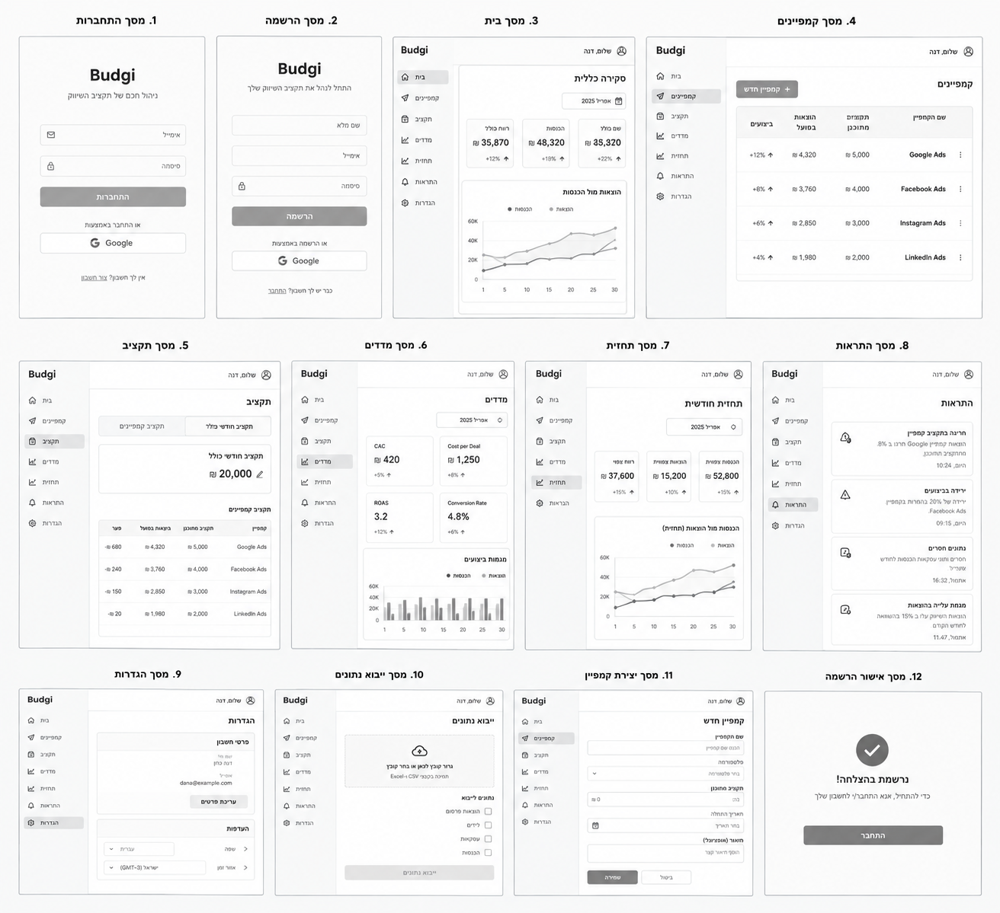
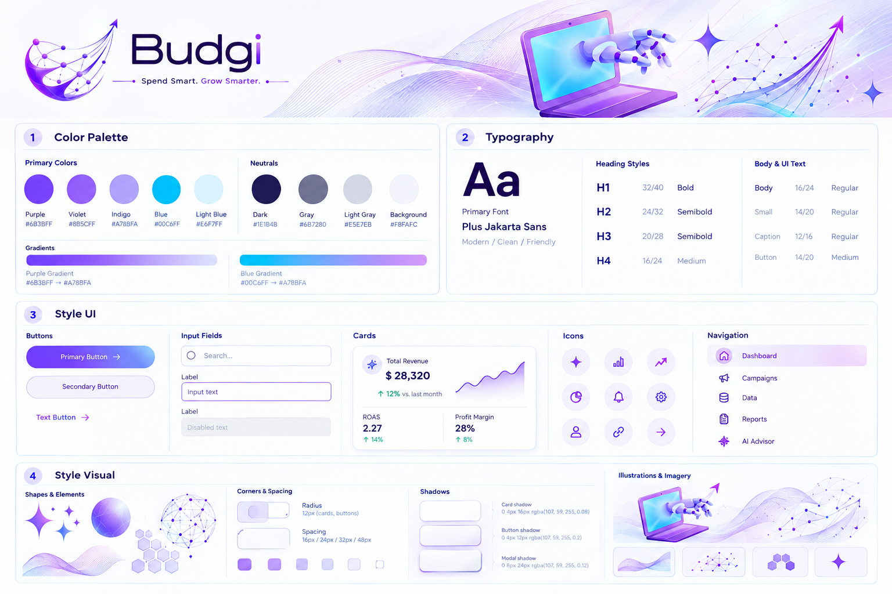
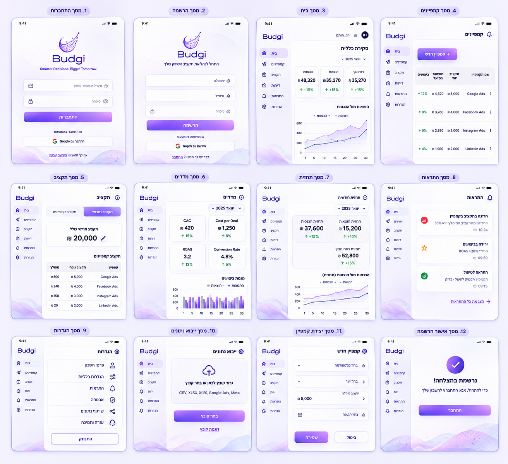
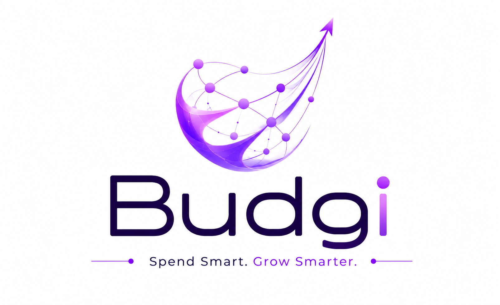

# DESIGN.md — Budgi

מסמך זה מתאר את מפרט העיצוב והמימוש החזותי של Budgi. הוא משלים את ה-PRD: ה-PRD הוא המקור להתנהגות ולדרישות המוצר, ה-Wireframes מגדירים את מבנה המסכים, וה-Style Guide וה-Mockups מגדירים את השפה החזותית ואת היישום שלה.

## מקורות חזותיים

### Wireframes — מבנה ופריסת המסכים

### Style Guide — השפה העיצובית

### Mockups — המראה החזותי המיועד

### לוגו

יש להשתמש בקובץ `logo.png` כלוגו המאושר, ולא לצייר מחדש את הסמל.

## סטיות מאושרות מהתמונות

התמונות נוצרו לפני שהתקבלו כמה החלטות מוצר. במקומות הבאים **הטקסט במסמך זה גובר על התמונות**:

- **התחברות והרשמה:** מסך התחברות אחד עם Google, ומתחתיו התחברות עם אימייל וסיסמה (1.1). יש מסך הרשמה עם אימייל, מסך „שכחתי סיסמה” ומסך „בחירת סיסמה חדשה” (1.17), בעיצוב פשוט לפי ה-Style Guide — לא לפי מסך 2 ב-Mockups. שדה „שם מלא” אינו חלק מהמוצר.
- **מסכים שאינם בתמונות:** הגדרה ראשונית (1.2) ודפי תנאי שימוש ופרטיות (1.13). הם מתוארים בטקסט בלבד, ומעוצבים לפי ה-Style Guide ולפי דפוסי המסכים הקיימים.
- **פרטי קמפיין (1.5) ו-AI Budget Advisor (1.12):** מופיעים ב-Mockups ונבנים לפי המראה שם, אך המבנה והתוכן נקבעים לפי הטקסט במסמך זה בכל מקום שיש סתירה.
- **מסכים ב-Mockups שאינם חלק מהמוצר:** „משתמשים” (מסך 23), ומסכי היסטוריית נתונים, השוואת קמפיינים ופרטים לפי פלטפורמה כמסכים נפרדים (מסכים 19–22). מהם נלקח רק הסגנון החזותי.
- **רווח:** כל כרטיס של "רווח", "רווח נקי" או "תחזית רווח" מוחלף כמתואר במסכים 1.3 ו-1.8.
- **שמות קמפיינים:** בתמונות שמות הקמפיינים הם שמות פלטפורמות (Google Ads, Facebook Ads, Instagram Ads). בפועל לטבלאות יש עמודת "פלטפורמה" נפרדת משם הקמפיין, והפלטפורמות הן רק Meta Ads, Google Ads, TikTok Ads ו-LinkedIn Ads.
- **גרפים:** הנתונים שבועיים, ולכן הגרפים מציגים נקודה או עמודה לכל שבוע ולא לכל יום (ראו 2.4).
- **ייבוא:** במקום בחירת פלטפורמה ותיבות סימון, תהליך של ארבעה שלבים (1.11).
- **הגדרות:** אין בחירת שפה או אזור זמן. נוספים אזורי יעדים, ספי התראה ומחיקת חשבון (1.10).
- **התראות:** אין התראת "נתונים חסרים".
- **ניווט:** רשימת הניווט הסופית מופיעה ב-1.15; "דוח" שמופיע ב-Mockups אינו פריט ניווט.
- **בורר תקופה:** חודש או שבוע (במסך התחזית: חודש בלבד).
- **עמודת "מומלץ"** במסך התקציב ב-Mockup אינה חלק מה-MVP.
- **צבע כפתור ראשי:** גרדיאנט סגול כהה יותר מזה שבתמונות, שנבחר על ידי בעל המוצר ועומד בדרישות הנגישות (ראו 2.1).
- **גופן:** טקסט עברי בגופן Rubik (ראו 2.2).
- **סלוגן:** הלוגו המלא, כולל השורה באנגלית „Spend Smart. Grow Smarter.”, מוצג רק במסך ההתחברות. בשאר המקומות (סרגל הניווט, הכותרת העליונה במובייל, המגירה, ההגדרה הראשונית ודפי תנאי השימוש והפרטיות) מוצג אותו לוגו חתוך מעל השורה הזו. אין סלוגן נוסף בעברית מתחת ללוגו.

---

# 1. Screens — מסכי האפליקציה

שמות המסכים נשמרים בעברית, בהתאם לשפת הממשק. בכל המסכים הפנימיים נעשה שימוש במסגרת האפליקציה המשותפת (Shell): סרגל ניווט צדדי, אזור תוכן מרכזי וכותרת עליונה עם פרטי המשתמש.

## 1.1 מסך התחברות

**מטרת המסך:** לאפשר כניסה והרשמה ל-Budgi באמצעות Google, או התחברות עם אימייל וסיסמה.

**מבנה ותוכן:**
- מסך ממוקד ומרוכז, ללא ה-Shell.
- לוגו Budgi (כמו שהוא, כולל השורה באנגלית).
- כפתור ראשי: „התחברות עם Google”, עם סמל Google, ומתחתיו: „עם Google, החשבון נוצר אוטומטית בהתחברות הראשונה.”
- קו מפריד עם „או”, ומתחתיו טופס: „אימייל”, „סיסמה” וכפתור משני „התחברות עם אימייל”.
- מתחת לטופס: קישור „שכחתי סיסמה” וקישור „אין לך חשבון? הרשמה עם אימייל”.
- בתחתית: קישורים ל„תנאי שימוש” ול„מדיניות פרטיות”.
- אלמנטים גרפיים עדינים מה-Style Guide (גלים, רשת Nodes) ברקע.

**פעולות וניווט:**
- לחיצה על הכפתור מפעילה התחברות Google.
- משתמש חדש, או משתמש שלא השלים הגדרה ראשונית, מועבר למסך ההגדרה הראשונית. משתמש קיים מועבר למסך הבית.
- אם ההתחברות נכשלה או בוטלה, מוצגת הודעת שגיאה קצרה מעל הכפתור, והמשתמש נשאר במסך. אימייל או סיסמה שגויים: „האימייל או הסיסמה שגויים”; חשבון שהאימייל שלו עוד לא אושר: הסבר לחפש את מייל האישור. קישור ממייל שפג תוקפו: „הקישור פג תוקף או כבר נוצל. בקש קישור חדש.”

## 1.2 מסך הגדרה ראשונית (חדש)

**מטרת המסך:** לאסוף את התקציב והיעדים הבסיסיים של משתמש חדש, פעם אחת.

**מבנה ותוכן:**
- מסך מרוכז ללא ה-Shell, ברוחב כרטיס (עד כ-560px), על רקע Background.
- בראש: לוגו, כותרת H2 „ברוכים הבאים ל-Budgi” ושורת הסבר: „נגדיר את התקציב ויעד ההכנסות לחודש הנוכחי. אפשר לשנות הכול בהמשך.”
- כרטיס אחד עם הטופס:
  - **תקציב שיווק חודשי** (חובה) — שדה סכום עם ₪.
  - **יעד הכנסות חודשי** (חובה) — שדה סכום עם ₪, ותחתיו טקסט עזר: „נמדד מול ההכנסות שתזין לקמפיינים.”
  - שורת עזר: „יעדים נוספים (עסקאות, לידים, ROAS מינימלי) אפשר להגדיר בהמשך במסך ההגדרות.”
  - כפתור ראשי ברוחב מלא: „התחל לעבוד עם Budgi”.

**פעולות וניווט:**
- שגיאות ולידציה מוצגות מתחת לכל שדה, בעברית.
- שמירה מוצלחת מעבירה למסך הבית, שיציג את המצב הריק (1.14).

## 1.3 מסך בית

**מטרת המסך:** להציג תמונת מצב מרכזית של תקציב השיווק והביצועים העסקיים.

**מבנה ותוכן:**
- ה-Shell, כותרת „סקירה כללית” ובורר תקופה (חודש או שבוע).
- שורת שלושה KPI cards: **הכנסות**, **הוצאות**, **יתרת תקציב**. בכל כרטיס: ערך ב-₪ והשוואה לתקופה הקודמת (חץ ואחוז) כשיש נתונים. בחודש הנוכחי, כשהנתונים עוד לא מכסים את כל החודש, ההשוואה היא לאותם ימים בחודש הקודם, עם הכיתוב „מול אותם ימים בחודש הקודם (1–N)”. בכרטיס „יתרת תקציב” מוצגת טבעת (עוגה) של ניצול התקציב החודשי, עם „נוצלו X% מהתקציב” בכתב; בחריגה הטבעת אדומה ו„חריגה: נוצלו X% מהתקציב”. בחודש שעוד לא נגמר אין ליתרה השוואה באחוזים.
- מתחת לכרטיסים, בתצוגת חודש בלבד, שני כרטיסים זה לצד זה (במובייל — זה מתחת לזה):
  - **„התקדמות ליעדים”**: שורה לכל יעד שהוגדר לחודש (הכנסות, עסקאות, לידים, ROAS מינימלי) — ערך בפועל מתוך היעד ופס התקדמות באחוזים. ב-ROAS מינימלי: ה-ROAS בפועל מול המינימום. כשלא הוגדר אף יעד — הסבר קצר וקישור „הגדרת יעדים”.
  - **„תחזית לסוף החודש”** (רק בחודש הנוכחי): הוצאות צפויות מול התקציב, הכנסות צפויות מול יעד ההכנסות, והתקדמות צפויה ליעד ההכנסות, עם קישור „לתחזית המלאה”. עם פחות מ-7 ימים מכוסים: „אין מספיק נתונים לתחזית”.
- גרף מגמה „הכנסות מול הוצאות”: בתצוגת חודש — נקודה לכל שבוע בחודש; בתצוגת שבוע — שמונת השבועות שמסתיימים בשבוע שנבחר.
- בתחתית, בכל תקופה וגם כשאין נתונים לתקופה, שני כרטיסים זה לצד זה:
  - **„התראות אחרונות”**: שלוש ההתראות האחרונות (כותרת, חומרה, זמן, וסימון „לא נקראה”), עם קישור „לכל ההתראות”. כשאין: „אין התראות.”
  - **„תובנות AI שמורות”**: שלוש התובנות האחרונות שנשמרו (השאלה, תחילת ההסבר ותאריך השמירה), עם קישור „לכל התובנות”. כשאין: „עוד לא נשמרו תובנות.” וקישור ל-AI Budget.

**פעולות וניווט:**
- שינוי התקופה מעדכן את הנתונים והגרפים.
- לחיצה על כרטיס „יתרת תקציב” פותחת את מסך התקציב.
- הקישורים בכרטיסי הסקירה פותחים את המסך המלא: הגדרות (יעדים), תחזית, התראות ו-AI Budget.

## 1.4 מסך קמפיינים

**מטרת המסך:** להציג את הקמפיינים ולספק השוואה מהירה בין התקציב המתוכנן, ההוצאות והביצועים בחודש הנוכחי.

**מבנה ותוכן:**
- ה-Shell, כותרת „קמפיינים”, וכפתורים: ראשי „קמפיין חדש”, משני „ייבוא נתונים”.
- מסנן סטטוס מעל הטבלה: „פעילים” (ברירת מחדל), „מושהים”, „הסתיימו”, „הכול”.
- טבלה עם העמודות: שם קמפיין, פלטפורמה, סטטוס (תגית), תקציב חודשי, הוצאה בפועל החודש, ROAS החודש, ושינוי ב-ROAS לעומת החודש הקודם. ערך שלא ניתן לחשב מוצג „—”.
- במובייל הטבלה הופכת לרשימת כרטיסים: שם, פלטפורמה ותגית סטטוס בשורה הראשונה; תקציב, הוצאה ו-ROAS בשורה השנייה.

**פעולות וניווט:**
- לחיצה על שורה פותחת את מסך פרטי הקמפיין.
- „קמפיין חדש” פותח את מסך יצירת קמפיין; „ייבוא נתונים” פותח את מסך הייבוא.

## 1.5 מסך פרטי קמפיין (חדש)

**מטרת המסך:** לצפות בקמפיין אחד, לערוך את פרטיו ולהזין או לעדכן את נתוני הביצועים השבועיים שלו. זה המסך העיקרי להזנת נתונים ידנית.

**מבנה ותוכן:**
- ה-Shell. בראש: קישור חזרה „← קמפיינים”, לוגו הפלטפורמה בגודל 32px ליד שם הקמפיין (H2), תגית פלטפורמה (עם הלוגו, ראו 2.3) ותגית סטטוס, וכפתור משני „עריכת פרטים”.
- **בורר חודש** מעל הכרטיסים (מהחודש הראשון עם נתונים ועד החודש הבא). ברירת המחדל: החודש הנוכחי אם יש בו נתונים לקמפיין, אחרת החודש האחרון שיש בו נתונים.
- **כרטיס תקציב החודש:** כותרת „תקציב <חודש> · <שם הקמפיין>”; תקציב מתוכנן לחודש שנבחר (עם אייקון עריכה), הוצאה בפועל ויתרה.
- **שורת KPI cards לחודש שנבחר:** CPL, Cost per Deal, CAC, ROAS (כמו במסך המדדים, בגודל קטן יותר).
- **טבלת „נתונים שבועיים”:** כותרת H3 עם שם הקמפיין („נתונים שבועיים · <שם>”), כפתור ראשי „הוספת שבוע” וכפתור משני „ייבוא קובץ” (פותח את מסך הייבוא לקמפיין הזה, 1.11). עמודות: שבוע (טווח תאריכים, למשל „25.10–31.10”), הוצאה, לידים, עסקאות, לקוחות חדשים, הכנסות, מקור (תגית „ידני” או „ייבוא”), ופעולות (עריכה, מחיקה). השבוע האחרון למעלה. שדה שלא הוזן מוצג „—”.
- **חלונית הזנת שבוע** (Modal במחשב, מסך מלא במובייל):
  - בחירת שבוע: Date Picker; כל תאריך שנבחר מוצג כטווח השבוע שלו (ראשון–שבת).
  - חמישה שדות מספריים: הוצאה (₪), לידים, עסקאות, לקוחות חדשים, הכנסות (₪). כולם אופציונליים, אבל צריך למלא לפחות אחד.
  - טקסט עזר: „שדה ריק נשמר כ'לא הוזן', לא כאפס.”
  - כפתורים: „שמירה” ו„ביטול”.
  - אם לשבוע שנבחר כבר יש נתונים, החלונית נפתחת עם הנתונים הקיימים לעריכה, ומוצגת הודעה על כך.
- **חלונית „עריכת פרטים”:** שם, פלטפורמה, סטטוס (פעיל / מושהה / הסתיים) ותיאור. בתחתית, רק לקמפיין בלי נתונים שבועיים: כפתור טקסט אדום „מחיקת קמפיין”, עם חלונית אישור.

**פעולות וניווט:**
- מחיקת שורת שבוע דורשת אישור בחלונית.
- כל שמירה מעדכנת את הכרטיסים ועלולה להציג התראה קופצת.

## 1.6 מסך תקציב

**מטרת המסך:** להציג ולנהל את התקציב החודשי הכולל ואת תקציבי הקמפיינים.

**מבנה ותוכן:**
- ה-Shell, כותרת „תקציב” ובורר חודש.
- בורר לשוניות: „תקציב חודשי כולל” ו„תקציבי קמפיינים”.
- **לשונית תקציב כולל:** כרטיס מרכזי עם התקציב החודשי (עם אייקון עריכה). מתחתיו שני נתונים:
  - „מוקצה לקמפיינים” — סכום תקציבי הקמפיינים, והפער מהתקציב הכולל. פער שלילי מוצג בצבע שגיאה עם הטקסט „הקצית יותר מהתקציב הכולל”.
  - „הוצאה בפועל” ו„יתרה” — מתוכנן מול בפועל לעסק כולו.
- **לשונית תקציבי קמפיינים:** טבלה עם קמפיין, פלטפורמה, תקציב מתוכנן (ניתן לעריכה בשורה), הוצאה בפועל ויתרה. יתרה שלילית בצבע שגיאה. בשורת הסיכום בתחתית: סכומים.
- סכומים מוצגים בשקלים חדשים (₪).

**פעולות וניווט:**
- המשתמש עורך את התקציבים ידנית; המלצות המערכת אינן משנות תקציב.

## 1.7 מסך מדדים

**מטרת המסך:** להציג מדדי ביצועים מחושבים ולהשוות בין תקופות.

**מבנה ותוכן:**
- ה-Shell, כותרת „מדדים”, בורר תקופה (חודש או שבוע) ולידו בורר „השוואה ל־” (חודש או שבוע מאותו סוג; ברירת מחדל: התקופה הקודמת). שינוי התקופה מחזיר את ההשוואה לברירת המחדל.
- חמישה KPI cards: CPL, Cost per Deal, CAC, ROAS ו-Conversion Rate (עסקאות ÷ לידים). בכל כרטיס: שם המדד, ערך, יחידה, הערך של תקופת ההשוואה (למשל „ספטמבר 2025: ₪45”), אחוז השינוי מולה, ואייקון מידע שמציג בריחוף/לחיצה את הנוסחה.
- כאשר חסרים נתונים או שהמכנה הוא אפס: „לא זמין” והסבר קצר (למשל „לא הוזנו לידים בתקופה”) במקום ערך.
- גרף „מגמת ביצועים”: עמודות של הוצאות והכנסות לכל שבוע (בתצוגת חודש — שבועות החודש; בתצוגת שבוע — שמונת השבועות האחרונים).
- טבלת השוואה בין קמפיינים: שם, פלטפורמה ומדדי התקופה. הגרף והטבלה מציגים את התקופה שנבחרה בלבד, לא את תקופת ההשוואה.

## 1.8 מסך תחזית

**מטרת המסך:** להציג תחזית חודשית להוצאות ולהכנסות עד סוף החודש.

**מבנה ותוכן:**
- ה-Shell, כותרת „תחזית חודשית” ובורר חודש.
- שלושה כרטיסים: **הוצאות צפויות**, **הכנסות צפויות**, **התקדמות צפויה ליעד** (באחוזים מיעד ההכנסות). כל כרטיס מציג גם את הנתון בפועל עד כה ואת היעד או התקציב.
- כשהוגדרו יעדים נוספים: שורת כרטיסים קטנים לכל יעד (עסקאות, לידים, ROAS) עם תחזית מול יעד.
- שורת „על מה מבוססת התחזית”: „לפי קצב החודש” או „לפי קצב החודש וממוצע החודשים הקודמים”, ו„התחזית היא הערכה ולא הבטחה”.
- גרף „הכנסות מול הוצאות (תחזית)”: קו רציף לשבועות עם נתונים, וקו מקווקו להמשך הצפוי עד סוף החודש.
- **אין מספיק נתונים** (פחות מ-7 ימים): במקום הכרטיסים והגרף — הודעה „אין עדיין מספיק נתונים לתחזית לחודש הזה. הזן לפחות שבוע אחד של נתונים.” וכפתור לקמפיינים.
- **חודש שהסתיים:** הכותרות מתחלפות ל„בפועל” ואין קו מקווקו.

## 1.9 מסך התראות

**מטרת המסך:** לרכז התראות על חריגות ושינויים בביצועים.

**מבנה ותוכן:**
- ה-Shell וכותרת „התראות”, ומסנן „הכול” / „לא נקראו”.
- רשימת כרטיסי התראה, החדשה למעלה. כל כרטיס: אייקון לפי סוג, כותרת קצרה, תיאור, שם הקמפיין (אם רלוונטי) וחותמת זמן. התראה שלא נקראה מסומנת בנקודה ורקע סגול בהיר.
- סוגי ההתראות: קצב הוצאות, חריגה מהתקציב, ירידה בביצועים, יעד בסיכון ויעד הושג (חיובית).
- צבעי סטטוס: חמורה — אדום, אזהרה — כתום, חיובית — ירוק. הטקסט והאייקון ברורים גם בלי צבע.
- **הודעה קופצת (Toast):** כשנוצרת התראה, מוצגת בפינה העליונה (בצד שמאל ב-RTL) למשך 6 שניות, עם כותרת ותיאור, וכפתור טקסט „לפרטים”. אייקון פעמון בכותרת העליונה של ה-Shell מציג את מספר ההתראות שלא נקראו.

**פעולות וניווט:**
- לחיצה על כרטיס מסמנת אותו כנקרא ופותחת את ההקשר: פרטי הקמפיין, מסך התקציב או מסך התחזית.
- קישור „ניהול ספי התראה” מוביל לאזור ההתראות במסך ההגדרות.

## 1.10 מסך הגדרות

**מטרת המסך:** לנהל את החשבון, היעדים והתראות.

**מבנה ותוכן:**
- ה-Shell וכותרת „הגדרות”. כרטיסים נפרדים לפי הסדר:
  1. **פרטי חשבון:** שם ואימייל מחשבון Google (לקריאה בלבד). מתחתם שדה „שם בית העסק” (אופציונלי, עד 100 תווים) עם טקסט עזר „אופציונלי. אם תמלא, השם יוצג בראש המסך במקום השם מ-Google.” וכפתור משני „שמירה”. שדה ריק = מוצג השם מ-Google.
  2. **יעדים:** בורר חודש, ושדות: יעד הכנסות, מספר עסקאות, מספר לידים, ROAS מינימלי. שדה ריק = אין יעד. כפתור „שמירת יעדים”.
  3. **התראות:** שורה לכל סוג התראה עם מתג הפעלה, תיאור קצר ושדה סף (באחוזים; ב„ירידה בביצועים” גם מספר שבועות להשוואה). כפתור „שמירת הגדרות התראות” וקישור טקסט „החזרה לברירת המחדל”.
  4. **מידע משפטי:** קישורים ל„תנאי שימוש” ול„מדיניות פרטיות”.
  5. **יציאה:** כפתור משני „התנתקות”.
  6. **אזור מסוכן:** כרטיס עם גבול אדום, הסבר שהמחיקה סופית, וכפתור „מחיקת החשבון”. בלחיצה נפתחת חלונית שבה מקלידים „מחק” כדי לאפשר את כפתור האישור.

## 1.11 מסך ייבוא נתונים

**מטרת המסך:** להעלות קובץ CSV או Excel ולעדכן נתוני קמפיינים, בתהליך מודרך.

**מבנה כללי:** ה-Shell, כותרת „ייבוא נתונים”, ומחוון שלבים (Stepper) עם ארבעה שלבים: העלאה, התאמת עמודות, בדיקה, סיום. כל השלבים באותו מסך.

**שלב 1 — העלאה:**
- אזור גרירה מרכזי עם אייקון העלאה: „גרור קובץ לכאן או בחר קובץ”, ושורת עזר: „CSV או Excel, עד 5MB ו-5,000 שורות”.
- קישור טקסט „הורדת קובץ דוגמה”, ושורת הסבר קצרה על העמודות הנדרשות.
- קובץ לא נתמך, ריק או גדול מדי — הודעת שגיאה מתחת לאזור הגרירה.

**שלב 2 — התאמת עמודות:**
- העמודות מזוהות אוטומטית לפי הכותרות של קובץ הדוגמה ולפי שמות נפוצים בקובצי ייצוא, באנגלית ובעברית (למשל `Campaign`, `Spend_ILS`, `Leads`, `Revenue_ILS`, `Date`). אם זוהו שם קמפיין, פלטפורמה ותאריך, השלב מדולג ומוצגת הודעה „העמודות זוהו אוטומטית”; אחרת השלב נפתח כשהעמודות שזוהו כבר מסומנות.
- אחרת: טבלה עם שורה לכל שדה של Budgi, לפי הסדר: פלטפורמה*, שם קמפיין*, תאריכים*, הוצאה, לידים, עסקאות, לקוחות חדשים, הכנסות. בעמודה האמצעית „מקור”, ובצד דוגמה של ערך מהשורה הראשונה.
  - **פלטפורמה:** רשימה נפתחת עם ארבע הפלטפורמות והלוגו („Meta Ads – לכל השורות” וכו'). עמודה מהקובץ מופיעה ברשימה רק אם זוהתה כעמודת פלטפורמה („לפי העמודה בקובץ: …”).
  - **שם קמפיין:** רשימה נפתחת של עמודות הקובץ.
  - **תאריכים:** שני שדות תאריך, „מתאריך” ו„עד תאריך”, לכל הקובץ. בצד מוצג השבוע שאליו יישמרו הנתונים (למשל „שבוע 01.11–07.11”, ו„(רוב הימים)” כשהטווח עובר בין שני שבועות). אפשר לבחור עד 8 ימים, או חודש מלא (מה-1 ועד היום האחרון בחודש) — אז מוצג למשל „אוקטובר 2026, מחולק ל-5 שבועות”. טווח אחר או תאריך סיום לפני תאריך ההתחלה — הודעת שגיאה מתחת לשדות. אם זוהתה בקובץ עמודת „תחילת שבוע”, מוצג במקום השדות „מהעמודה „תחילת שבוע” בקובץ” עם קישור „הזנת תאריכים ידנית”.
  - **הוצאה עד הכנסות:** רשימה נפתחת של עמודות הקובץ, כולל „לא לייבא”.
- מתחת לטבלה — הסבר קצר על כלל השבוע.
- כפתור „המשך” פעיל רק כששדות החובה מולאו ותקינים; לידו שורה שמציינת מה עוד חסר (למשל „יש לבחור: פלטפורמה, תאריכים”).

**שלב 3 — בדיקה (תצוגה מקדימה):**
- שורת כרטיסי סיכום: „שורות חדשות”, „עדכונים לנתונים קיימים”, „קמפיינים חדשים שייווצרו”, „שורות עם שגיאות”.
- רשימת הקמפיינים החדשים (שם ופלטפורמה), עם הסבר שהם ייווצרו בסטטוס „פעיל”.
- טבלת שגיאות: מספר שורה בקובץ והסיבה, בעברית. הערה על שורות שתאריך השבוע שלהן הותאם ליום ראשון (לא בקובץ יומי).
- שורות של אותו קמפיין ואותו שבוע מתחברות לשורת שבוע אחת, עם הסבר מעל הכרטיסים (בקובץ יומי: „הקובץ מכיל נתונים יומיים: הימים של כל קמפיין חוברו לשבועות”). בחודש מלא: הסבר שהנתונים חולקו לשבועות החודש לפי ימים (הערכה).
- כפתורים: ראשי „ייבוא X שורות” ומשני „חזרה”.

**שלב 4 — סיום:**
- אייקון הצלחה, סיכום מה נשמר ומה נדחה, וכפתורים „מעבר לקמפיינים” ו„ייבוא קובץ נוסף”.

**ייבוא לקמפיין אחד** (נפתח מכפתור „ייבוא קובץ” במסך פרטי הקמפיין, 1.5):
- אותו מסך ואותם ארבעה שלבים. בראש: קישור חזרה עם שם הקמפיין, כותרת „ייבוא נתונים לקמפיין”, ושם הקמפיין עם תגית הפלטפורמה.
- שלב 2 תמיד מוצג, בלי שורות הפלטפורמה ושם הקמפיין: רק תאריכים* ועמודות הנתונים (לפחות אחת). הסבר: כל שורות הקובץ (למשל מודעה בכל שורה) יחוברו לשורת שבוע אחת בקמפיין.
- שלב 3: משפט „X שורות מהקובץ יחוברו לשבוע … בקמפיין …”, וטבלה עם שורה לכל שדה: „סה״כ בקובץ”, „שמור עכשיו” (רק כשלשבוע כבר יש נתונים) ו„יישמר”. כשלשבוע יש נתונים — הודעה שהערכים מהקובץ יחליפו אותם ושדה בלי ערך יישאר. שורות שגויות מוצגות ברשימה עם מספר שורה וסיבה, והכפתור הראשי „שמירה לקמפיין” כבוי עד שהקובץ מתוקן. כפתור משני „חזרה”.
- שלב 4: „הנתונים נשמרו”, איזה שבוע נוסף או עודכן, וכפתורים „חזרה לקמפיין” ו„ייבוא קובץ נוסף”.

## 1.12 מסך AI Budget Advisor (חדש)

**מטרת המסך:** לשוחח עם ה-AI בשפה חופשית ולקבל ניתוח והמלצות על התקציב.

**מבנה ותוכן:**
- ה-Shell. כותרת „AI Budget” עם אייקון הכוכב מה-Style Guide, ושורת הסבר: „שאל על התקציב והקמפיינים שלך. ההמלצות הן הצעות בלבד — שינויים מתבצעים ידנית.”
- בצד השמאלי של הכותרת (ב-RTL): מונה „נותרו X מתוך 20 שאלות היום”.
- **אזור השיחה:** במרכז, ברוחב קריאה (עד כ-760px). הודעות המשתמש בבועה בצבע Light Blue בצד ימין; תשובות ה-AI בכרטיס לבן בצד שמאל, עם אייקון הכוכב.
- **תשובת AI** מורכבת מ:
  - טקסט ההסבר.
  - **כרטיסי המלצה** (אחד לכל המלצה): תגית סוג הפעולה („העברת תקציב”, „הגדלה”, „הקטנה”), שמות הקמפיינים, הסכום ב-₪ ו/או האחוז בגופן בולט, „למה” (הנימוק), ו„השפעה צפויה” כשיש. גבול ימני סגול.
  - **אזור „הסתייגויות”** בגוון Gray, כשיש מגבלות או נתונים חסרים.
  - כשחסרים נתונים: כרטיס עם הסבר מה חסר, כפתור „להזנת נתונים” שפותח את רשימת הקמפיינים (ראו „בחירת קמפיין” למטה) וכפתור „לייבוא”.
  - בתחתית הכרטיס: כפתור משני קטן „שמור תובנה” עם אייקון סימנייה. אחרי השמירה הכפתור מתחלף ל„נשמרה” (מושבת, עם אייקון ✓).
- **„תובנות שמורות”:** בין שורת ההסבר לאזור השיחה — אזור מתקפל עם הכותרת „תובנות שמורות (N)”, סגור כברירת מחדל ומוצג רק כשיש לפחות תובנה אחת. בפתיחתו: רשימת כרטיסים לבנים, מהחדשה לישנה. בכל כרטיס: תאריך השמירה (DD/MM/YYYY), השאלה בגופן מודגש, טקסט ההסבר, כרטיסי ההמלצה וההסתייגויות באותו עיצוב כמו בשיחה, וכפתור אייקון „מחיקה” עם אישור. תובנה שנשמרה עכשיו מופיעה ברשימה מיד.
- **מצב פתיחה (לפני השאלה הראשונה):** איור עדין מה-Style Guide, ושלושה כפתורי הצעה לשאלות: „איפה כדאי להגדיל תקציב החודש?”, „איזה קמפיין הכי פחות יעיל?”, „האם אעמוד ביעד ההכנסות?”.
- **שורת קלט** בתחתית, קבועה: שדה טקסט (עד 1,000 תווים) וכפתור שליחה. בזמן המתנה לתשובה: אנימציית טעינה בכרטיס תשובה ריק, והקלט מושבת.
- הודעה קבועה מעל שורת הקלט: „השיחה אינה נשמרת ותימחק ביציאה מהמסך. תשובות שתשמור יופיעו בתובנות השמורות.”

**מצבים מיוחדים:**
- **אין נתונים בחשבון:** במקום כפתורי ההצעה — הסבר שצריך קודם להזין נתונים, כפתור ראשי „קמפיינים” שפותח את רשימת הקמפיינים (ראו „בחירת קמפיין” למטה) וכפתור „ייבוא נתונים”.
- **בחירת קמפיין להזנת נתונים:** לחיצה על הכפתור פותחת רשימה נפתחת עם הכיתוב „בחר קמפיין להזנת נתונים” ושורה לכל קמפיין של המשתמש — לוגו הפלטפורמה ושם הקמפיין — שפותחת את מסך פרטי הקמפיין (1.5), שבו מזינים נתונים שבועיים. ברשימה ארוכה יש גלילה בתוך הרשימה. כשעוד אין קמפיינים: במקום הכפתור, כפתור „קמפיין חדש” שפותח את מסך יצירת קמפיין (1.16).
- **מגבלה יומית נוצלה:** שורת הקלט מושבתת עם ההודעה „ניצלת את 20 השאלות להיום. אפשר לשאול שוב מחר.”
- **שגיאה מהשירות:** כרטיס שגיאה בתוך השיחה „לא הצלחנו לקבל תשובה כרגע. נסה שוב.” וכפתור „נסה שוב”. שאלה שנכשלה אינה נספרת במגבלה.

## 1.13 דפי תנאי שימוש ומדיניות פרטיות (חדש)

- שני דפים פשוטים ללא ה-Shell: לוגו קטן בראש, כותרת H1, טקסט בגוף Body ברוחב קריאה, וקישור חזרה.
- נגישים גם ללא התחברות.
- עד שיסופק הנוסח המשפטי, הדף מציג: „התוכן יעודכן בקרוב.”

## 1.14 מצבים ריקים, טעינה ושגיאה

**מצב ריק** — לכל מסך, כשאין עדיין נתונים: אייקון או איור קטן מה-Style Guide, כותרת קצרה, משפט הסבר וכפתור לצעד הבא.

| מסך | טקסט | כפתור |
|---|---|---|
| בית, מדדים | „עוד אין נתונים לתקופה הזו” | „הוספת קמפיין” או „ייבוא נתונים” |
| קמפיינים | „עוד לא נוצרו קמפיינים” | „קמפיין חדש” |
| פרטי קמפיין (טבלת שבועות) | „עוד לא הוזנו נתונים לקמפיין הזה” | „הוספת שבוע” ו„ייבוא קובץ” |
| תקציב (קמפיינים) | „אין קמפיינים להקצאת תקציב” | „קמפיין חדש” |
| התראות | „אין התראות. נעדכן כשמשהו ידרוש תשומת לב.” | — |

**טעינה:** Skeleton (משטחים אפורים בהירים בצורת התוכן) בכרטיסים, בטבלאות ובגרפים; לא ספינר על כל המסך.

**שגיאה:** כרטיס עם הודעה בעברית וכפתור „נסה שוב”. שגיאות שמירה מוצגות כ-Toast אדום.

## 1.15 מבנה הניווט הכללי

- המסכים ללא ה-Shell: התחברות, הרשמה, שכחתי סיסמה, בחירת סיסמה חדשה, הגדרה ראשונית, תנאי שימוש ומדיניות פרטיות.
- פריטי הניווט, לפי הסדר: „בית”, „קמפיינים”, „תקציב”, „מדדים”, „תחזית”, „AI Budget”, „התראות”, „ייבוא נתונים”, „הגדרות”.
- מסכי יצירת קמפיין ופרטי קמפיין נפתחים מתוך „קמפיינים”, ופריט „קמפיינים” נשאר מסומן בהם.
- **כותרת עליונה:** אייקון פעמון עם מונה התראות שלא נקראו, ושם המשתמש עם אייקון. אם הוגדר שם בית עסק (1.10), מוצג הוא עם אייקון תיק עבודה (Lucide `BriefcaseBusiness`) במקום השם מ-Google ואייקון המשתמש.
- **מחשב וטאבלט (768px ומעלה):** סרגל צדדי קבוע בצד ימין.
- **מובייל (מתחת ל-768px):** הסרגל הצדדי מוסתר. בכותרת העליונה: כפתור ☰ בצד ימין, הלוגו במרכז ופעמון ההתראות בצד שמאל. השם (שם בית העסק או השם מ-Google, עם האייקון) אינו מוצג בכותרת אלא בראש המגירה, מתחת ללוגו. לחיצה על ☰ פותחת את אותו סרגל ניווט כמגירה מצד ימין מעל התוכן, עם רקע כהה שקוף; לחיצה על פריט או מחוץ למגירה סוגרת אותה.

## 1.16 מסך יצירת קמפיין

**מטרת המסך:** ליצור קמפיין חדש.

**מבנה ותוכן:**
- ה-Shell, קישור חזרה וכותרת „קמפיין חדש”.
- שדות: שם הקמפיין (חובה), פלטפורמה (חובה; רשימה: Meta Ads, Google Ads, TikTok Ads, LinkedIn Ads), תקציב מתוכנן לחודש הנוכחי (אופציונלי, ₪), תיאור (אופציונלי).
- כפתורי „שמירה” ו„ביטול”.
- שגיאה אם כבר קיים קמפיין עם אותו שם ואותה פלטפורמה.

**פעולות וניווט:**
- „שמירה” יוצרת קמפיין בסטטוס „פעיל” ופותחת את מסך פרטי הקמפיין, כדי להזין שבוע ראשון.
- „ביטול” חוזר למסך הקמפיינים.

---

## 1.17 מסכי הרשמה ואיפוס סיסמה (חדש)

מסכים פשוטים ללא ה-Shell, באותו כרטיס מרוכז של מסך ההתחברות (לוגו קטן, כותרת, טופס), עם קישורי תנאי שימוש ופרטיות בתחתית.
- **הרשמה עם אימייל:** „אימייל”, „סיסמה” (לפחות 15 תווים), „אימות סיסמה”, כפתור ראשי „הרשמה” וקישור „כבר יש לך חשבון? התחברות”. אחרי השליחה: „בדוק את תיבת הדואר” — נשלח קישור לאישור הכתובת; הקישור מעביר להגדרה הראשונית.
- **שכחתי סיסמה:** „אימייל” וכפתור „שליחת קישור לאיפוס”. אחרי השליחה: הודעה שאם יש חשבון לכתובת, נשלח אליה קישור (אותה הודעה בכל מקרה).
- **בחירת סיסמה חדשה:** נפתח מהקישור במייל. „סיסמה חדשה”, „אימות סיסמה” וכפתור „שמירת הסיסמה”; אחרי השמירה — מסך הבית.

---

# 2. Style Guide — השפה העיצובית

## 2.1 Color Palette

השפה החזותית מבוססת על סגול וטווחי Violet/Indigo, עם נגיעות כחול בהיר. הרקע בהיר מאוד, והמשטחים לבנים או כמעט לבנים. הצבעים משמשים להדגשת פעולות, נתונים, מצבי בחירה והיררכיה.

| תפקיד | שם צבע | HEX |
|---|---|---|
| צבע ראשי | Purple | `#6B3BFF` |
| צבע ראשי משני | Violet | `#8B5CFF` |
| צבע משלים | Indigo | `#A78BFA` |
| צבע משלים | Blue | `#00C6FF` |
| צבע משלים בהיר | Light Blue | `#E6F7FF` |
| טקסט כהה / בסיס כהה | Dark | `#1E1B4B` |
| טקסט משני | Gray | `#6B7280` |
| גבולות ומשטחים ניטרליים | Light Gray | `#E5E7EB` |
| רקע | Background | `#F8FAFC` |

**צבעי סטטוס** (לשימוש פונקציונלי בלבד): הצלחה `#15803D`, אזהרה `#B45309`, שגיאה `#DC2626`. כל השלושה עומדים בניגודיות 4.5:1 על רקע לבן, ולכן מתאימים גם לטקסט.

**Gradients**
- **Button Gradient:** `#603E9F` → `#814AC9`. לכפתורים ראשיים ולכל רקע שעליו טקסט לבן. ניגודיות טקסט לבן: 5.5:1 לפחות לאורך כל הגרדיאנט.
- Purple Gradient: `#6B3BFF` → `#A78BFA`. לשימוש דקורטיבי בלבד (רקעים, הדגשות, פריט ניווט נבחר) — לא מתחת לטקסט לבן.
- Blue Gradient: `#00C6FF` → `#A78BFA`. צבע משלים לשימוש נקודתי בלבד.

**כללי שימוש**
- Purple הוא צבע הפעולה וההדגשה המרכזי.
- **טקסט סגול:** טקסט ואייקונים בסגול על רקע לבן או בהיר (קישורים, כפתור משני, כפתור טקסט, פריט ניווט נבחר) בצבע `#814AC9`. ניגודיות: 5.6:1 על לבן, ו-4.9:1 לפחות על הרקע הסגול הבהיר של פריט נבחר.
- Violet ו-Indigo משמשים להדרגתיות, גרפים, מצבי Hover/Selected והדגשות משניות.
- Dark משמש לכותרות ולטקסט ראשי; Gray לטקסט משני, תוויות ומידע משלים.
- Light Gray משמש לגבולות, מפרידים ורקעים עדינים של רכיבים.
- Background הוא בסיס המסכים.
- צבעי הסטטוס אינם מחליפים את הצבע הראשי של המותג.
- כל שילוב של טקסט ורקע חייב לעמוד ביחס ניגודיות של 4.5:1 לפחות (3:1 לטקסט גדול מ-18px או מודגש מ-14px). Indigo ו-Light Gray אינם משמשים כצבע טקסט.

## 2.2 Typography

- **Plus Jakarta Sans** — לטקסט באנגלית, למספרים ולסכומים, ולמונחים כמו ROAS ו-CPL.
- **Rubik** — לכל הטקסט בעברית.
- הגדרת הגופן: `font-family: "Plus Jakarta Sans", "Rubik", sans-serif`. הדפדפן משתמש אוטומטית ב-Plus Jakarta Sans לאותיות לטיניות ולספרות, וב-Rubik לאותיות עבריות. שני הגופנים נטענים מ-Google Fonts.

| סגנון | גודל / Line Height | משקל |
|---|---:|---|
| H1 | 32/40 | Bold |
| H2 | 24/32 | Semibold |
| H3 | 20/28 | Semibold |
| H4 | 16/24 | Medium |
| Body | 16/24 | Regular |
| Small | 14/20 | Regular |
| Caption | 12/16 | Regular |
| Button | 14/20 | Medium |

**היררכיה ושימוש**
- כותרת ראשית אחת לכל מסך, בדרך כלל H2.
- כותרות של אזורי תוכן וכרטיסים משתמשות ב-H3 או H4.
- ערכים מרכזיים ב-KPI cards בגודל H2–H1 וב-Semibold, בולטים יותר מתוויות המדד.
- טקסטי עזר, תאריכים, יחידות והשוואות משתמשים ב-Small או Caption.
- סכומים מוצגים עם מפריד אלפים וסימן ₪ באופן עקבי (למשל ₪12,500). מספרים שלמים ללא נקודה עשרונית; ROAS עם ספרה אחת אחרי הנקודה; אחוזים עם ספרה אחת לכל היותר.

## 2.3 UI Style

### כפתורים
- **Primary Button:** רקע Button Gradient, טקסט לבן, Radius 12px וצל עדין. מיועד לפעולה הראשית במסך.
- **Secondary Button:** רקע לבן, גבול סגול עדין וטקסט Purple.
- **Text Button:** ללא משטח; טקסט Purple ואייקון חץ לפי הצורך.
- **Danger Button:** טקסט או גבול בצבע שגיאה, לפעולות מחיקה בלבד.
- גובה כפתורים אחיד (40px; 44px במובייל). מצבי Hover, Focus ו-Disabled ברורים. מצב Focus מסומן בטבעת Purple בעובי 2px.

### שדות וטפסים
- רקע לבן, גבול Light Gray או Purple במצב Focus, ופינות מעוגלות.
- תווית השדה מעל השדה. שדות חובה מסומנים בכוכבית.
- שגיאה: גבול בצבע שגיאה והודעה מתחת לשדה.
- שדות סכום מציגים ₪ בתוך השדה; שדות מספר מקבלים מקלדת מספרית במובייל.
- שדות Select ו-Date Picker ישמרו על אותו גובה, Radius ויישור כמו שדות הטקסט.

### Cards
- משטח לבן, גבול עדין בגוון Light Gray/סגול בהיר, Radius של 12px ו-Card shadow עדין.
- KPI cards מציגים תווית, ערך מרכזי והשוואה או שינוי כאשר הנתון זמין. שינוי לטובה בירוק, לרעה באדום — עם חץ, כך שהמשמעות ברורה גם בלי צבע. (ב-CPL, CAC ו-Cost per Deal ירידה היא לטובה.)
- יש לשמור על גובה וריווח עקביים בכרטיסים מאותה קבוצת מידע.

### טבלאות ורשימות
- כותרות עמודות ברורות, טקסט קומפקטי וריווח מספק בין שורות.
- קווי הפרדה עדינים במקום גבולות כבדים.
- סכומים ומדדים מיושרים באופן עקבי; שמות קמפיינים ופלטפורמות נשארים קריאים.

### Navigation
- סרגל צדדי בהיר עם לוגו Budgi ופריטי ניווט הכוללים אייקון ותווית.
- פריט נבחר מקבל רקע סגול בהיר/Gradient עדין, טקסט ואייקון בצבע Purple.
- במובייל — מגירה, כמתואר ב-1.15.

### תגית פלטפורמה
- בכל מקום שבו מוצגת פלטפורמת פרסום (טבלאות, פרטי קמפיין, יצירת קמפיין, תקציב, תצוגה מקדימה של ייבוא) היא מוצגת כתגית: לוגו הפלטפורמה בגודל 16px ושם הפלטפורמה. ברשימות בחירה, הלוגו מופיע ליד כל אפשרות.
- הלוגואים: Meta, Google Ads, TikTok ו-LinkedIn, כקובצי SVG בצבעים הרשמיים, מתוך ספריית `simple-icons` (או מערכות המותג הרשמיות של הפלטפורמות). אין לשנות את צורת הלוגו או את צבעיו.
- ללוגו יש טקסט חלופי עם שם הפלטפורמה.

### Icons
- אייקונים בקו נקי ופשוט (Outline), בצבע Purple/Dark, ממשפחה אחת (Lucide, הכלולה ב-shadcn/ui). לוגואי הפלטפורמות הם החריג היחיד.
- אייקונים בתוך עיגולים בהירים משמשים לסימון KPI, התראות ופעולות.
- אין להשתמש באייקונים בלי תווית כאשר המשמעות אינה ברורה; לכפתור אייקון בלבד יש תווית נגישות.

## 2.4 Visual Style

### צורות, פינות וגבולות
- שפה רכה ומודרנית המבוססת על Cards, משטחים מעוגלים וקווי מתאר דקים.
- Radius לרכיבי Cards וכפתורים: 12px; לשדות: 10px.

### Shadows
- Card shadow: `0 4px 16px rgba(107, 59, 255, 0.08)`.
- Button shadow: `0 4px 12px rgba(107, 59, 255, 0.2)`.
- Modal shadow: `0 8px 24px rgba(107, 59, 255, 0.12)`.

### Spacing ו-Layout
- סולם המרווחים: `16px`, `24px`, `32px`, `48px` (ו-`8px` למרווחים בתוך רכיב).
- ב-Desktop: סרגל צדדי ברוחב 240px ואזור תוכן ברוחב מקסימלי של 1280px.
- בטאבלט: שתי עמודות בכרטיסי KPI.
- במובייל: עמודה אחת, ריווח צד 16px. טבלאות רחבות הופכות לכרטיסים או נגללות אופקית בתוך המכל שלהן.

### Charts ו-Data Visualization
- ציר X: שבועות, עם תווית תאריך תחילת השבוע (למשל „25.10”).
- הכנסות ב-Purple, הוצאות ב-Indigo; קו תחזית מקווקו.
- רקע בהיר; Gridlines דקים וניטרליים.
- הבחנה בין סדרות באמצעות גוון, סוג קו/סימון ומקרא — לא רק צבע.
- נתונים חסרים לא יוצגו כאפס; שבוע בלי נתונים מוצג כרווח בקו.
- Tooltip בריחוף/לחיצה עם הערכים המדויקים.

### Illustrations ואלמנטים גרפיים
- אלמנטים מופשטים מה-Style Guide (רשתות Nodes, גלים, כוכבים) — בעדינות, במסכי ההתחברות וההגדרה הראשונית, וברקע כל המסכים הפנימיים (מאחורי התוכן, לא בסרגל הצדדי), לבקשת בעל המוצר.
- הקישוט אינו פוגע בקריאוּת: הכרטיסים והטבלאות לבנים, והניגודיות של הטקסט נשמרת.

### אווירה כללית
- Modern, Clean, Friendly, High-Tech.
- מוצר SaaS פיננסי מתקדם, אך נגיש ולא מאיים.

## 2.5 שפה, כיווניות ונגישות

- שפת הממשק היא עברית, וברירת המחדל היא `RTL`.
- כותרות, תוויות, טפסים, כרטיסים ורשימות מיושרים לימין. הסרגל הצדדי בצד ימין.
- מונחים מקצועיים, שמות פלטפורמות ונתונים באנגלית מוצגים ב-LTR מקומי בתוך ממשק RTL.
- מספרים, תאריכים (DD.MM או DD/MM/YYYY), אחוזים וסכומי ₪ נשארים קריאים ולא מתהפכים עקב BiDi.
- כל טקסט UI חדש נכתב בעברית, למעט שמות מקצועיים/מותגים/פלטפורמות.
- **נגישות (ת"י 5568 / WCAG 2.0 AA):** ניגודיות לפי 2.1; כל פעולה זמינה במקלדת עם Focus גלוי; לכל שדה תווית; לאייקונים ולגרפים חלופה טקסטואלית; הודעות Toast נקראות על ידי קוראי מסך; אין הסתמכות על צבע בלבד; הממשק תקין בהגדלת טקסט ל-200%.

---

## הנחיות מימוש מסכמות

- המסכים במוצר: התחברות, הרשמה ואיפוס סיסמה, הגדרה ראשונית, בית, קמפיינים, יצירת קמפיין, פרטי קמפיין, תקציב, מדדים, תחזית, התראות, הגדרות, ייבוא נתונים, AI Budget Advisor, ודפי תנאי שימוש ומדיניות פרטיות. אין להוסיף מסכים או וריאציות שלא הוגדרו.
- Wireframes הם המקור למבנה המסכים שמופיעים בהם, ו-Mockups למראה החזותי — בכפוף לסעיף „סטיות מאושרות מהתמונות”.
- אין להציג חישובי Profit או Profit Margin ב-MVP, גם אם דוגמה מופיעה ב-Style Guide.
- יש להציג נתונים חסרים כלא זמינים ולא כאפס או כהערכה לא מבוססת.
- כל שינוי עתידי במבנה המסכים צריך להתעדכן תחילה במסמך זה וב-PRD, ולא להיווצר מתוך החלטת עיצוב בלבד.
